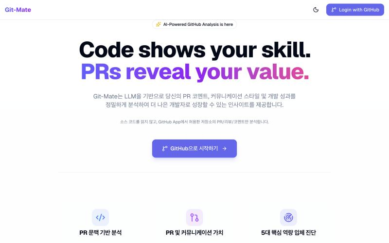
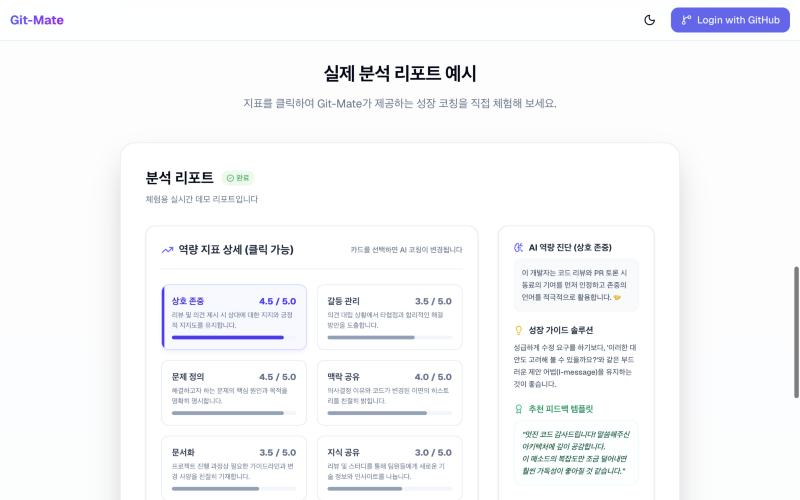
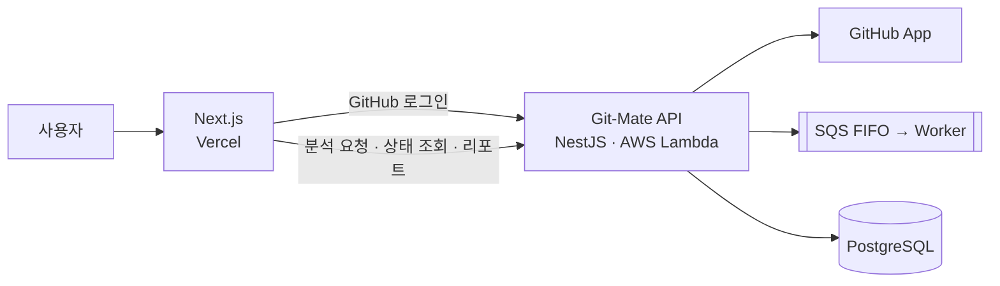

# Git-Mate Frontend

> GitHub Pull Request와 코드 리뷰 활동을 분석해 **이력서로는 보이지 않는 개발자의 협업·엔지니어링 역량**을 리포트로 보여주는 서비스의 프론트엔드입니다.

🔗 **서비스** [git-mate-frontend.vercel.app](https://git-mate-frontend.vercel.app)  
⚙️ **백엔드 레포** [chya-chya/git-mate-backend](https://github.com/chya-chya/git-mate-backend)



---

## 목차

1. [왜 만들었나](#1-왜-만들었나)
2. [주요 기능](#2-주요-기능)
3. [기술 스택](#3-기술-스택)
4. [아키텍처](#4-아키텍처)
5. [구현 포인트](#5-구현-포인트)
6. [나의 역할과 기여](#6-나의-역할과-기여)
7. [로컬 실행](#7-로컬-실행)
8. [품질 검사](#8-품질-검사)
9. [배포](#9-배포)
10. [프로젝트 구조](#10-프로젝트-구조)

---

## 1. 왜 만들었나

- 개발자의 협업 역량은 GitHub의 PR과 리뷰 기록에 이미 남아 있지만, 이를 한눈에 보기는 어렵습니다.
- Git-Mate는 이 기록을 LLM으로 분석해 **역량 지표와 성장 코칭**으로 보여줍니다.
- 소스 코드는 읽지 않고, GitHub App으로 허용한 저장소의 **PR·리뷰·코멘트만** 분석한다는 점을 사용자에게 투명하게 안내합니다.

## 2. 주요 기능



| 기능 | 화면 | 설명 |
|---|---|---|
| 서비스 소개 · 데모 리포트 | `/` | 분석 방식과 권한 범위를 안내하고, 로그인 없이 예시 리포트를 체험할 수 있습니다. 지표 카드를 누르면 지표별 AI 진단, 성장 가이드, 추천 피드백 문장이 바뀝니다. |
| GitHub 로그인 | `/auth/callback` | GitHub 계정으로 로그인합니다. |
| 대시보드 | `/dashboard` | 최근 역량 분석 결과를 레이더 차트로 보여줍니다. |
| 저장소 분석 | `/repositories` | GitHub App으로 허용한 저장소를 보고, 예상 토큰을 확인한 뒤 분석을 요청합니다. 분석은 백그라운드 Job으로 진행되며 단계별 진행률을 보여줍니다. |
| 분석 리포트 | `/analysis/[id]` | 8개 협업 역량 지표와 코칭을 보여줍니다. 리포트를 이미지 카드로 저장하거나 공개 링크로 공유할 수 있습니다. |
| 보고서 관리 | `/analysis-reports` | 내 전체 분석 보고서와 공유 중인 리포트를 한곳에서 관리합니다. |
| 공개 리포트 | `/public`, `/public/[username]` | 공유된 개발자 리포트를 탐색하고 열람합니다. |
| 설정 | `/settings` | GitHub App 저장소 선택을 관리하고 계정을 삭제할 수 있습니다. |

## 3. 기술 스택

| 영역 | 기술 |
|---|---|
| Framework | Next.js 16 (App Router), React 19 |
| Language | TypeScript |
| Styling / Animation | Tailwind CSS 4, Framer Motion |
| 서버 상태 | TanStack Query 5 |
| 클라이언트 상태 | Zustand |
| 차트 | Recharts |
| 이미지 내보내기 | html-to-image |
| HTTP | axios |
| 배포 | Vercel |

## 4. 아키텍처



- 프론트엔드는 백엔드 API를 통해 로그인, 분석 요청과 상태 조회, 리포트 조회·공유를 처리합니다.
- 백엔드의 비동기 파이프라인 구조는 [백엔드 README](https://github.com/chya-chya/git-mate-backend#4-아키텍처)를 참고하세요.

## 5. 구현 포인트

- **비동기 분석 Job 연동:** 분석 요청을 `POST /analysis/jobs`로 접수하고, TanStack Query의 `refetchInterval`로 2초마다 상태를 조회해 수집·분석·저장 단계와 진행률을 보여줍니다. 완료되면 폴링을 멈추고 리포트로 이동합니다. (`src/services/analysisJob.ts`, `src/app/repositories/[githubRepoId]/analyze/page.tsx`)
  - Job ID를 URL에 남겨, 새로고침하거나 페이지를 떠났다 돌아와도 진행 상황을 이어서 봅니다.
  - `Idempotency-Key` 헤더로 중복 클릭이 중복 Job을 만들지 않게 하고, 이미 진행 중인 Job이 있으면(`409`) 그 Job을 이어서 추적합니다.
  - 실패 코드를 사용자 안내 문구로 바꾸고, 재시도 가능한 실패는 `다시 시도` 버튼으로 재접수합니다.
  - 백엔드에서 비동기 경로가 꺼져 있으면(`503 ASYNC_ANALYSIS_DISABLED`) 기존 동기 API로 자동 전환합니다.
- **역할에 따른 상태 분리:** 서버 데이터는 TanStack Query 캐시로, 로그인 사용자 정보는 Zustand 스토어로 관리합니다.
- **리포트 공유:** 리포트를 PNG 분석 카드로 내보내거나(html-to-image), 공개 전환 후 `/public/[username]` 링크로 공유할 수 있습니다.
- **권한 투명성:** 랜딩과 설정 화면에서 GitHub App이 접근하는 범위(허용한 저장소의 PR·리뷰·코멘트)를 명확히 안내합니다.

## 6. 나의 역할과 기여

| 항목 | 내용 |
|---|---|
| 형태 | 개인 프로젝트 (기획 · 백엔드 · 프론트엔드 · 인프라) |
| 기간 | 2026.04 ~ 2026.06 |

- 화면 설계와 UI 구현
- 랜딩 페이지와 체험용 데모 리포트
- GitHub 로그인과 GitHub App 연동 흐름
- 대시보드, 저장소 분석, 리포트, 공개 공유, 설정 화면
- Vercel 배포와 환경변수 관리
- OpenAI Codex를 코딩 에이전트로 활용

## 7. 로컬 실행

### 사전 요구사항

- Node.js 20 이상
- 실행 중인 Git-Mate 백엔드 ([백엔드 로컬 실행 방법](https://github.com/chya-chya/git-mate-backend#7-로컬-실행))

### 1) 저장소 클론 및 패키지 설치

```bash
git clone https://github.com/chya-chya/git-mate-frontend.git
cd git-mate-frontend
npm ci
```

### 2) 환경변수 설정

```bash
cp .env.example .env.local
```

| 변수 | 설명 | 로컬 예시 | 필수 |
|---|---|---|---|
| `NEXT_PUBLIC_API_URL` | Git-Mate 백엔드 API 주소 | `http://localhost:3000` | ✅ |

### 3) 개발 서버 실행

백엔드가 3000번 포트를 사용하므로, 프론트엔드는 **3001번 포트**로 실행합니다.

```bash
npm run dev -- -p 3001
```

http://localhost:3001 에 접속합니다.

> 백엔드 `.env`의 `FRONTEND_URL`도 `http://localhost:3001`로 맞춰야 CORS와 로그인 리다이렉트가 정상 동작합니다.

### Docker로 실행

```bash
docker compose up --build
```

컨테이너는 http://localhost:3001 로 열리며, `NEXT_PUBLIC_API_URL=http://localhost:3000`이 설정되어 있습니다.

## 8. 품질 검사

```bash
npm run lint     # ESLint
npm run build    # 타입 체크 및 프로덕션 빌드
```

## 9. 배포

- `main` 브랜치에 push하면 Vercel이 자동으로 배포합니다.
- Vercel 프로젝트 환경변수에 `NEXT_PUBLIC_API_URL`(운영 백엔드 Function URL)을 설정합니다.

## 10. 프로젝트 구조

```
src/
├── app/            # 페이지와 라우트 (App Router)
├── components/     # analysis, layout, ui 컴포넌트
├── hooks/          # 커스텀 훅 (분석 상태 폴링 등)
├── services/       # API 호출 (analysis, githubApp, user)
├── store/          # Zustand 스토어
└── utils/          # 설정과 유틸리티
docs/images/        # README 이미지
public/             # 정적 파일
```
